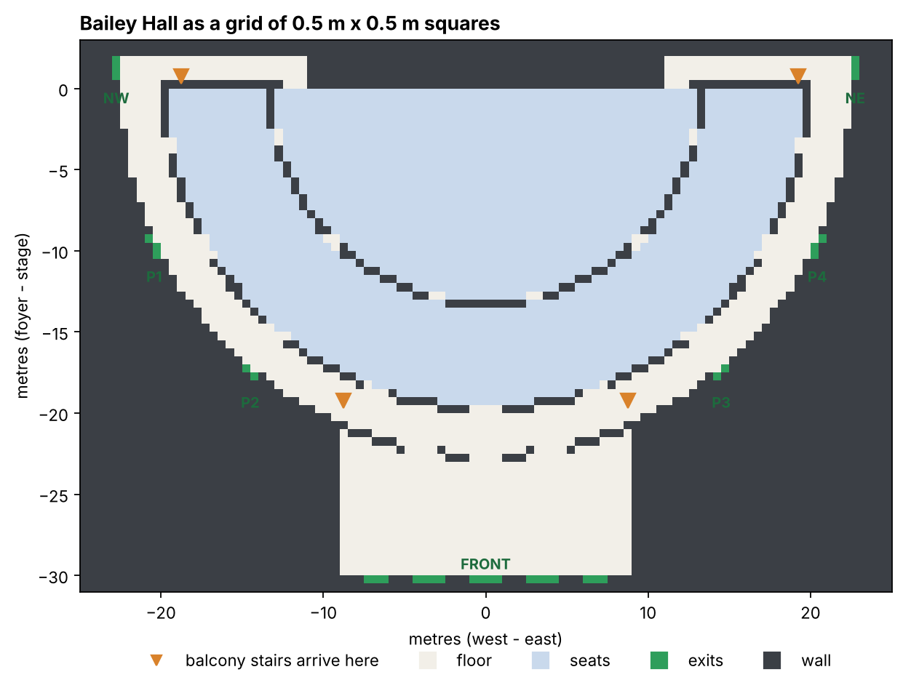
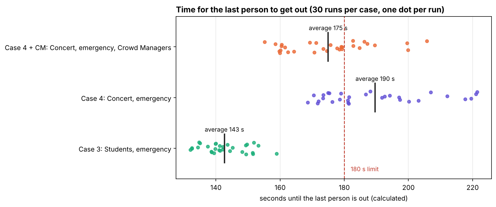
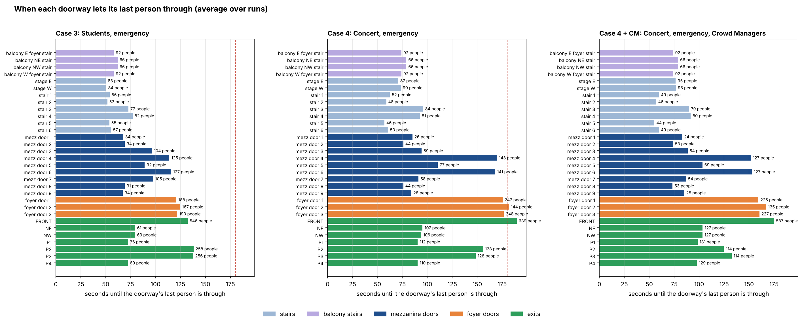
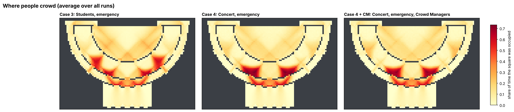
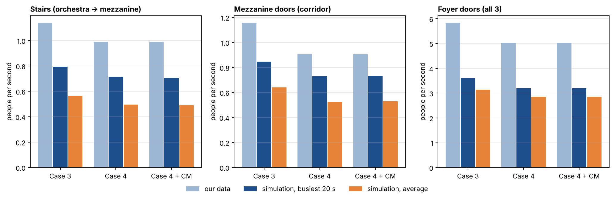
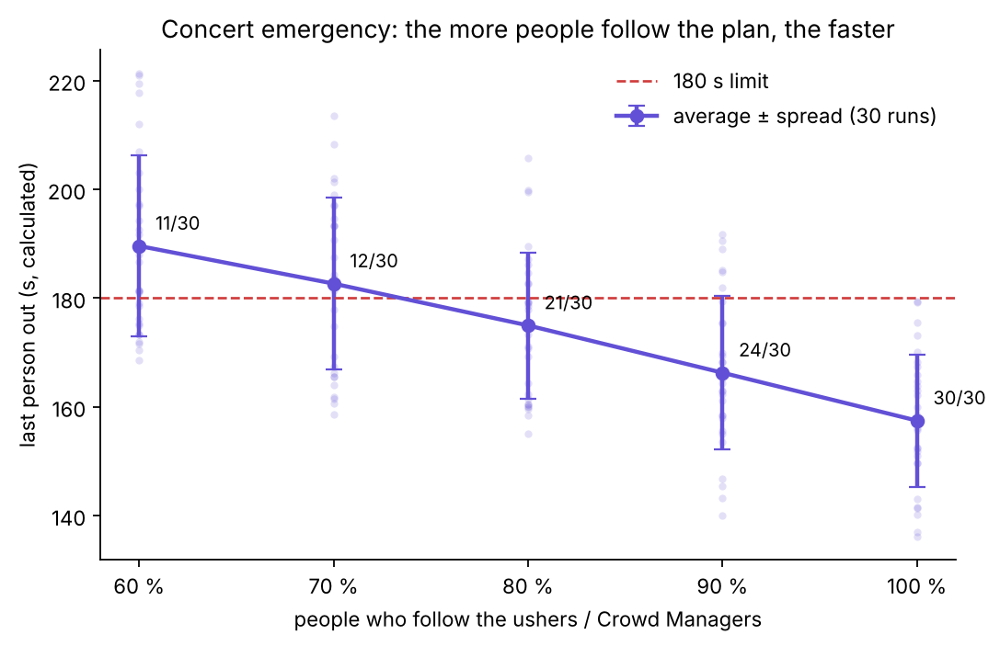

# Bailey Hall evacuation: a simple grid simulation

CMCM 2026, "Bail(ey)ing Out". How long does it take 1,329 people to leave Bailey Hall in an emergency?

We draw the hall as a grid of small squares and let every person take one step at a time.
The narrow doorways (the stairs, the mezzanine doors and the foyer doors) let people through at the rates we measured in our own bottleneck simulations.
Each step is partly random, so we repeat every evacuation 30 times.

The simulation tells us **how many people go through each doorway** (the same counts behind the heat map).
From those counts and each doorway's flow rate we then **calculate when the last person gets out** (rule 10).

We simulate the two **emergency** cases from our data, plus the concert with Crowd Managers:

| Case | Who | Data used | Reaction time | How people pick an exit |
|---|---|---|---|---|
| 3 | Students (lecture) | case 3 | 5 s | 60% nearest exit, 40% habit (front foyer) |
| 4 | Concert audience | case 4 | 10 s | 60% follow the ushers, 25% habit, 15% nearest exit |
| 4 + CM | Concert audience, with Crowd Managers | case 4 | 10 s | **80% follow the ushers**, 12.5% habit, 7.5% nearest |

For the Crowd Manager scenario we assume the Crowd Managers **halve the number of people who ignore the ushers** (40% → 20%). The rest keep the concert's habit : nearest ratio of 25 : 15. We don't use 100%: in a real evacuation some people never listen, and Question 4 (barriers and LEDs) needs room to improve on it. Because the true share is unknown, we also run a sweep from 60% to 100% guided (see below).
Everything else is the same as case 4: the same measured doorway rates, and the same reaction time.

## How to run

```bash
pip install -r requirements.txt
python main.py
```

It takes about 3–4 minutes. The results go into the `output/` folder.

## Files

| File | What it does |
|---|---|
| `simulation.py` | The model: the map, distances, people, choosing an exit, moving step by step, and the doorway limits from our data. |
| `main.py` | Runs each case 30 times, prints a summary and draws the figures. |
| `sweep.py` | Runs the concert with 60%, 70%, 80%, 90% and 100% guided (about 9 minutes). |
| `data/` | Our measured bottleneck data: `stairs.csv`, `corridor.csv`, `foyer_doors.csv`. |
| `output/` | `map.png`, `escape_time.png`, `doorway_times.png`, `heatmap.png`, `flow_check.png`, `results.csv`, `guided_sweep.png`, `guided_sweep.csv` |

## Our bottleneck data

Each data file holds 4 cases × 500 runs of a separate small simulation of one bottleneck:

- **Case 1:** students, no emergency
- **Case 2:** concert, no emergency
- **Case 3:** students, emergency
- **Case 4:** concert, emergency

We use cases 3 and 4.

| File | Where in the hall | Doorways in our map | Measured flow, case 3 | Measured flow, case 4 |
|---|---|---|---|---|
| `stairs.csv` | the stairs from the orchestra up to the mezzanine | the 6 openings in the barrier | 1.14 people/s | 0.99 people/s |
| `corridor.csv` | the exit from the mezzanine towards the foyer | the 9 mezzanine doors | 1.16 people/s | 0.90 people/s |
| `foyer_doors.csv` | the 3 doors from the corridor into the foyer | the 3 foyer doors | 5.83 people/s (all 3 together) | 5.04 people/s |

These are averages; every run uses its own row of the data (see rule 7).

## How the simulation works

### 1. The hall is a grid of 0.5 m × 0.5 m squares

One square holds one person. The hall is 50 m × 34 m, so the grid is 100 × 68 squares.
Each square is one of four things:

- **wall**
- **floor** (corridor, foyer, aisles)
- **seat**
- **exit**

The shapes are drawn at the hall's real size:

- orchestra seats in a half-circle of 13 m;
- a barrier with **6 stair openings** up to the mezzanine;
- mezzanine seats from 13.5 m to 19.5 m;
- a wall with **9 doors** into a 2.4 m curved corridor;
- **3 doors** into the foyer;
- **7 exits**:
  - **FRONT**: the 5 foyer doors;
  - **P1–P4**: side doors from the corridor;
  - **NW and NE**: doors next to the stage.

The orange squares on the map are the doorways that use our data.



### 2. Distance maps

For every exit, the computer counts how many steps each square is from it.
It starts at the exit and spreads out one step at a time, like a wave (a *breadth-first search*).
People can step in 8 directions, but never into a wall, and never diagonally between two walls.

### 3. People

- **Where they start:**
  - 527 people sit in random orchestra seats and 486 in random mezzanine seats.
  - The 316 balcony people come down 4 staircases. Each staircase is a waiting line, and people step off it at the staircase's flow rate (see "Doorways without data" below).
- **Behaviour type:** each person gets one by a random draw, using the percentages for the case (see the table at the top).
- **Reaction time:** everyone starts moving after 5 s (students) or 10 s (concert). Balcony people need another 16 s to get down their stairs.

### 4. Choosing an exit

- **Habit:** FRONT.
- **Nearest:** the exit with the smallest distance.
- **Guided:** the ushers spread people out. One at a time, each guided person is sent to the exit where they would get out soonest:

  `walking distance + (people already sent there) ÷ (door width × 0.28 people per square per step)`

### 5. Moving, one time step at a time

One time step is **0.42 s**, the time it takes to walk one square at 1.19 m/s.
In each step, everyone who is ready does this:

**a. Score the options.**
The options are the free squares around you, plus staying where you are. Each one gets a weight:

```
weight = exp( −3 × (change in distance to my exit)  −  0.3 × (number of people around that square) )
```

- A step 1 square closer to your exit is about **20 times** more likely than a step that keeps the same distance.
- Squares surrounded by people are less attractive. This is how **congestion** works.

**b. Pick one option at random,** with chances in proportion to the weights. This is the **probability rule**.

**c. Resolve conflicts.**
If two or more people picked the same square, **one of them, chosen at random, gets it**, and the others wait.

**d. Leave the building.**
Anyone who steps onto an exit square is out, and we write down the time.

**e. Count crowding.**
We count how often every square is occupied. This gives the **density map**.

### 6. People see queues and pick a less busy doorway

Every 5 s, each doorway's queue is counted: the people within 4 m in front of it.
That doorway then counts as farther away, by the time you would wait in its queue:

`waiting steps = people in the queue ÷ (the doorway's measured rate × 0.42 s)`

The distance maps are redrawn with this extra cost.
Because squares now cost different amounts, the plain wave becomes **Dijkstra's method**: the same wave, but it always continues from the closest square found so far.

### 7. Doorways use our measured flow rates ("ticket machines")

Every stair opening, mezzanine door and foyer door has a ticket machine.

- **Printing tickets:** every time step, the machine prints `measured rate × 0.42 s` of a ticket. At most 1 ticket can wait.
- **Using tickets:** you may step **into** the doorway only if a ticket is ready, and stepping in uses it. With no ticket, you wait.
- **Where the rates come from:** run number *i* uses row *i* of each data file for the case. That way the run-to-run spread in our data carries into the simulation:
  - every stair opening gets the stair rate from `stairs.csv`;
  - every mezzanine door gets the rate from `corridor.csv`;
  - the foyer rate from `foyer_doors.csv` is split over the 3 doors in the same proportions as the data's door counts.

### 8. Two stuck people facing each other squeeze past

If two people can't move and each wants the other's square, they swap places half of the time.
Without this rule, two streams walking in opposite directions can block each other forever: this happened in one test run at the east end of the corridor.
Swaps never happen inside a doorway, so the ticket machines still decide who goes through.

### 9. Repeat 30 times per case

Each run uses a different random seed (0–29), and the same seed always gives exactly the same run.
The program also checks every step that no square ever holds two people.

### 10. Calculating when the last person gets out

While people walk, the simulation writes down **which doorways each person goes through**, in order.
For example: seat → stair 3 → mezz door 4 → foyer door 1 → FRONT.
From that we calculate the escape time (`calculated_escape_time` in `simulation.py`), working outwards from the seats:

1. **Count** how many people went through each doorway, and which doorways feed which (stair 3 feeds mezz door 4, and so on).
2. For every doorway, find:
   - **earliest**: when the first person can reach it. That's the reaction time plus the walk from their seat, or the earliest time of the doorway before it plus the walk between the two.
   - **finish**: when its last person is through. This is the later of:
     - **earliest + people ÷ flow rate** (everyone squeezing through at the doorway's rate), and
     - **when its last person arrives** (the doorway before it finishing, plus the walk). Nobody can pass a doorway before they get there.
3. The time the last person leaves the hall is the **latest finish of any exit**.

**Flow rates:**
- **Doorways with data:** they use the run's measured rate: stairs, mezzanine doors, and the foyer doors (split by the data's door counts).
- **Doorways without data:** the side exits, the front doors, the stage-side openings and the balcony stairs use

  `rate = the mezzanine doors' measured flow per metre × the doorway's width`

  The widths, estimated from the drawings, are in `NO_DATA_WIDTHS`.

The step-by-step simulation's own finishing time is still printed and saved, for comparison (`simulated_time_s` in `results.csv`).

## Results (30 runs per case)

| | Case 3: students | Case 4: concert | Case 4 + CM: concert with Crowd Managers |
|---|---|---|---|
| **Calculated time until the last person is out** | **143 s** | **190 s** | **175 s** |
| Spread between runs (standard deviation) | 7 s | 17 s | 13 s |
| Fastest / slowest run | 132 s / 159 s | 169 s / 221 s | 155 s / 206 s |
| Runs within the 180 s limit | **30 of 30** | **11 of 30** | **21 of 30** |
| Doorways that finish last | P2 and P3 (138 s), FRONT (132 s) | FRONT (190 s), foyer door 2 (182 s) | FRONT (175 s), foyer door 2 (167 s) |
| Step-by-step simulation's own time (for comparison) | 190 s | 245 s | 227 s |

Average number of people per exit:

| Case | FRONT | NW | NE | P1 | P2 | P3 | P4 |
|---|---|---|---|---|---|---|---|
| 3: students | 546 | 63 | 61 | 76 | 258 | 256 | 69 |
| 4: concert | 639 | 106 | 107 | 112 | 128 | 128 | 110 |
| 4 + CM: concert with Crowd Managers | 587 | 127 | 127 | 131 | 114 | 114 | 129 |



**Calculated time for the last person to get out.** One dot per run, with the average marked.

- **Students:** always within 180 s. They react faster and 60% use the nearest exit, so the hall empties through all exits. The side doors P2 and P3 next to the foyer finish last; about 255 people each use them.
- **Concert:** only about a third of the runs make 180 s. The foyer route decides it: 639 people go out the front.
- **Concert with Crowd Managers:** **15 s faster on average (175 s vs 190 s), and 21 of 30 runs make 180 s instead of 11.** About 50 fewer people go out the front, and the less-used exits (NW, NE, P1, P4) get about 128 each instead of about 110. The slowest runs still miss the limit, which leaves room for barriers and LEDs (Question 4).



**When each doorway lets its last person through** (average over the runs; the label shows how many people used it).
The longest bar decides the escape time.

- **Concert:**
  - The 3 foyer doors and the FRONT exit finish last.
  - Before them, mezzanine doors 4 and 6, the ones next to the foyer, take about 140 people each and finish at about 170 s.
- **Concert with Crowd Managers:**
  - Fewer people queue at mezzanine doors 4 and 6, and the front exit drops to 587 people.
  - The foyer route still finishes last, but about 15 s earlier.
- **Students:** the load is spread more evenly, and the side doors P2 and P3 finish last.



**Where people crowd.** The share of time each square was occupied, averaged over all runs.

- The dark red queues sit **in front of the mezzanine doors next to the foyer**, and in the corridor in front of the 3 foyer doors.
- **Concert:** 25% go back to the foyer by habit, and the ushers send many people there too. So the queues in front of the foyer-side mezzanine doors are the longest.
- **Concert with Crowd Managers:** the queues at the foyer-side mezzanine doors are shorter. More people walk through the far mezzanine doors toward the side exits, which shows up as light orange near the stage ends.
- **Students:** 60% head for the nearest exit, so there are also queues at the mezzanine doors near the P2 and P3 side exits.



**Do the doorways stay within our data?**
For each kind of doorway the chart shows three bars:
- our measured flow;
- the busiest 20 seconds in the simulation;
- the simulation's average while the doorway was in use.

The simulation never goes above the measured rate, so the ticket machines work. It also never quite reaches it, for two reasons:
- **Supply:** the foyer doors only get the people that the mezzanine doors (about 1 per second each) and the balcony stairs pass on.
- **Room behind the door:** a doorway can only take the next person when the square behind it is free.

**Why the calculated time is shorter than the step-by-step simulation's own time:**
In the calculation every doorway works at its full measured rate while it has people waiting.
In the step-by-step simulation the doorways only reach about 60–80% of those rates, because people sometimes wobble, and the square behind a doorway must be free before the next person can enter.
So the calculated time is what our measured rates allow, and the simulation's own time is a slower, more pessimistic estimate.

**What decides the time:**
Our data says each mezzanine door and stair opening lets through only about 1 person per second.
People don't spread evenly over the 9 mezzanine doors: the doors closest to the foyer get about 140 people each, while the far ones get fewer than 45.
This points to where guidance (ushers or LED signs) could help most: spreading people over the mezzanine doors and away from the foyer.
The Crowd Manager scenario confirms it: with 80% instead of 60% following the ushers' plan, the concert gets out about 15 s faster.

### How much does following the plan matter? (`python sweep.py`)

The share of people who follow Crowd Managers is a guess, so we ran the concert emergency with 60% to 100% guided (30 runs each; the non-guided people split 25 : 15 between habit and nearest).

| People guided | 60% (no CM) | 70% | **80% (our CM case)** | 90% | 100% (best case) |
|---|---|---|---|---|---|
| Calculated time (average ± spread) | 190 ± 17 s | 183 ± 16 s | **175 ± 13 s** | 166 ± 14 s | 158 ± 12 s |
| Runs within 180 s | 11 of 30 | 12 of 30 | **21 of 30** | 24 of 30 | 30 of 30 |



- Every extra 10% of people who follow the plan saves about **8 s**.
- The **average** drops below 180 s from about 75% guided, but **every** run makes it only at 100%.
- So Crowd Managers alone help, but they aren't enough on their own: Question 4 (barriers and LEDs) has to close the remaining gap.

## Simplifications

- **Separate data:** the doorway rates come from separate small simulations of one bottleneck each. We use them as the most a doorway can let through.
- **Doorways without data:** the side exits (P1–P4, NW, NE), the front doors, the stage-side openings and the balcony stairs use the mezzanine doors' measured flow per metre × their estimated width.
  - In the step-by-step simulation, only the balcony stairs get a ticket machine with that rate.
  - The others are limited only by the squares, but they do use the rate in the calculation.
- **The calculation** assumes each doorway works at its full rate while people wait, and uses the shortest walk between doorways. It doesn't add the time a doorway sits idle because the doorway before it is slow, except through the "last person arrives" rule.
- **Map:** one floor, simplified shapes, door widths estimated from the CMCM drawings. The balcony itself isn't drawn.
- **Speed and reaction:** everyone walks at the same speed, and reaction time is fixed and the same for everyone.
- **Ushers / Crowd Managers:** modelled only through the exit each guided person is given (the ushers' spread-out plan). They don't stand in the hall or talk to people on the way. In the Crowd Manager scenario we assume 80% follow them (an assumption; `sweep.py` shows 60–100%).

All the settings are named constants at the top of `simulation.py`.
