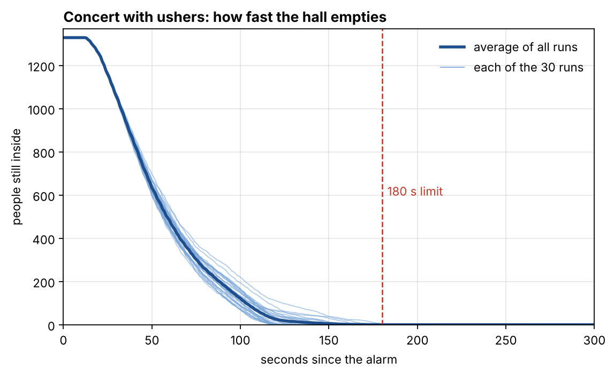

# Bailey Hall evacuation: a simple grid simulation

CMCM 2026, "Bail(ey)ing Out". How long does it take 1,329 concert-goers to leave Bailey Hall when there's an alarm?

We draw the hall as a grid of small squares and let every person take one step at a time.
Each step is partly random, so we repeat the whole evacuation 30 times and look at the results.

## How to run

```bash
pip install -r requirements.txt
python main.py
```

It takes about half a minute. The results go into the `output/` folder.

## Files

| File | What it does |
|---|---|
| `simulation.py` | The model: the map, distances, people, choosing an exit, and moving step by step. |
| `main.py` | Runs the simulation 30 times, prints a summary and draws the figures. |
| `output/` | `map.png`, `people_left.png`, `heatmap.png`, `results.csv` |

## How the simulation works

### 1. The hall is a grid of 0.5 m × 0.5 m squares

One square holds one person. The hall is 50 m × 34 m, so the grid is 100 × 68 squares.
Each square is one of four things:

- **wall**
- **floor** (corridor, foyer, aisles)
- **seat**
- **exit**

The shapes are drawn with "is this point inside the circle or rectangle?" checks, at the hall's real size:

- orchestra seats in a half-circle of 13 m;
- a barrier with **6 openings** up to the mezzanine;
- mezzanine seats from 13.5 m to 19.5 m;
- a wall with **9 doors** into a 2.4 m curved corridor;
- **3 doors** from the corridor into the foyer;
- **7 exits**:
  - **FRONT**: the 5 foyer doors;
  - **P1–P4**: the side doors from the corridor;
  - **NW and NE**: the doors next to the stage.


### 2. Distance maps

For every exit, the computer counts how many steps each square is from it.
It starts at the exit and spreads out one step at a time, like a wave (a *breadth-first search*).
People can step in 8 directions, but never into a wall, and never diagonally between two walls.

### 3. People

- **Where they start:**
  - 527 people sit in random orchestra seats and 486 in random mezzanine seats.
  - The 316 balcony people come down 4 staircases. Each staircase is a waiting line: the next person steps onto the floor when the bottom square of the stairs is free.
- **Behaviour type:** each person gets one by a random draw.
  - **60% guided**: they follow the ushers.
  - **25% habit**: they go back the way they came in, through the front foyer.
  - **15% nearest**: they go to the closest exit.
- **Reaction time:** everyone starts moving **10 s** after the alarm. Balcony people need another 16 s to get down their stairs.

### 4. Choosing an exit

- **Habit:** FRONT.
- **Nearest:** the exit with the smallest distance.
- **Guided:** the ushers spread people out. One at a time, each guided person is sent to the exit where they would get out soonest:

  `walking distance + (people already sent there) ÷ (door width × 0.28 people per square per step)`

### 5. Moving, one time step at a time

One time step is **0.42 s**, the time it takes to walk one square at 1.19 m/s.
In each step, everyone who is ready does this:

**a. Score the options.**
The options are the free squares around you, plus staying where you are. Each one gets a weight:

```
weight = exp( −3 × (change in distance to my exit)  −  0.3 × (number of people around that square) )
```

- A step 1 square closer to your exit is about **20 times** more likely than a step that keeps the same distance.
- A step backwards is about **20 times less** likely.
- Squares surrounded by people are less attractive. This is how **congestion** works: people avoid crowded spots.

**b. Pick one option at random,** with chances in proportion to the weights. This is the **probability rule**: people usually head for their exit, but they wobble and sidestep like real people.

**c. Resolve conflicts.**
If two or more people picked the same square, **one of them, chosen at random, gets it**, and the others stay where they are this step.

**d. Leave the building.**
Anyone who steps onto an exit square is out, and we write down the time.

**e. Count crowding.**
We add 1 to a counter for every occupied square. At the end this gives the **density map**: the share of time each square was occupied.

The program also checks every step that no square ever holds two people.

### 6. Repeat 30 times

Each run uses a different random seed (0, 1, 2, … 29), so the seats, behaviour types and steps come out differently each time.
Using the same seed always gives exactly the same run.

## Results (concert with ushers, 30 runs)

| | |
|---|---|
| Average time until the last person is out | **137 s** |
| Spread between runs (standard deviation) | 20 s |
| Fastest / slowest run | 118 s / 185 s |
| Runs within the 180 s limit | **29 of 30** |

Average number of people per exit:

| FRONT | NW | NE | P1 | P2 | P3 | P4 |
|---|---|---|---|---|---|---|
| 639 | 106 | 107 | 111 | 128 | 128 | 110 |



**People still inside over time.**
- The thin lines are the 30 runs and the thick line is their average.
- Most of the hall empties in about 2 minutes.
- What decides the result is how long the last few people take, and that varies from run to run.


**Where people crowd.**
- The colour shows the share of time each square was occupied, averaged over all runs. Seats count too: people sit there during the 10 s reaction time.
- The red patches are queues. They form at the 6 openings from the orchestra up to the mezzanine and at the mezzanine doors near the foyer.
- These narrow openings, not the exits themselves, are where people wait longest.

## Simplifications

- **Map:** one floor, with simplified shapes and door widths estimated from the CMCM drawings. The balcony itself isn't drawn; balcony people appear at the bottom of their stairs.
- **Speed:** everyone walks at the same speed, including through the seat rows.
- **Reaction time:** fixed and the same for everyone (10 s, plus 16 s on the balcony stairs).
- **Ushers:** modelled only by how they spread the guided 60% over the exits. They don't move.
- **Scenario:** only the concert with ushers is simulated. To try other mixes, change the `SHARE_` numbers at the top of `simulation.py`.

All the settings are named constants at the top of `simulation.py`, so they're easy to change and rerun.
